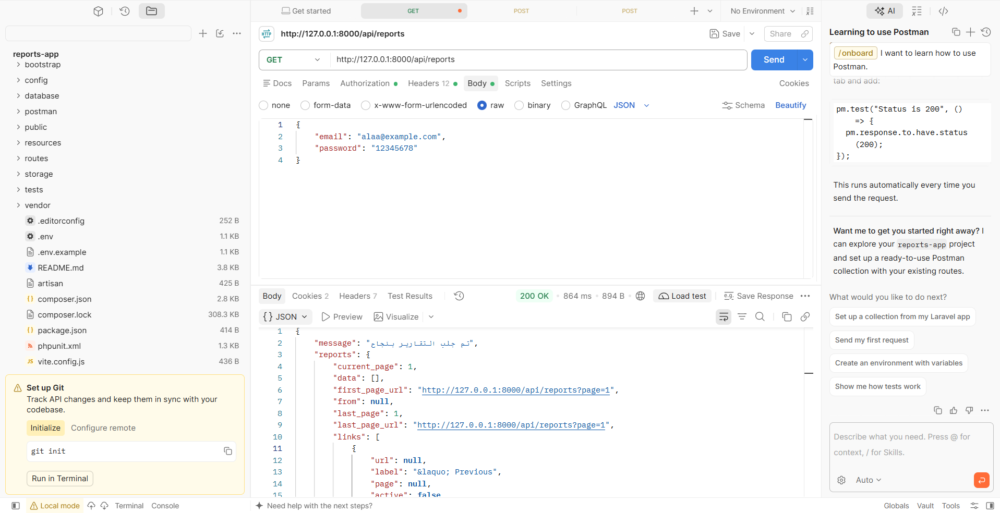
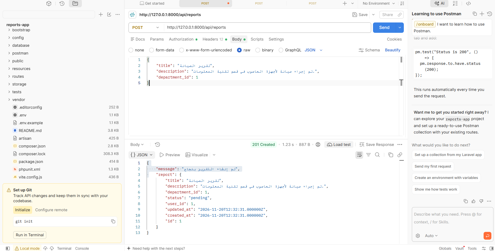

Reports Management System

A Laravel RESTful API for managing reports with role-based access control.

Features
Create, view, update, and delete reports.
Admin can manage all reports.
Department Managers can manage reports within their departments.
Regular Users can view their own reports and create new reports.
Authentication using Laravel Sanctum.
Role-based access control.
Technologies Used
PHP
Laravel
MySQL
Laravel Sanctum
RESTful API
Postman
API Testing with Postman

Postman was used to test the Reports API endpoints and verify that all operations work correctly.

The API was tested to ensure successful report creation, retrieval, updating, and deletion, as well as proper authentication and authorization.

Testing Included
GET: Retrieve reports.
POST: Create new reports.
PUT/PATCH: Update reports.
DELETE: Delete reports.
Verify API responses and HTTP status codes.
Test authentication using Bearer Tokens.
API Endpoints
Method	Endpoint	Description
GET	/api/reports	Get all reports
POST	/api/reports	Create a new report
GET	/api/reports/{id}	Get a specific report
PUT	/api/reports/{id}	Update a report
DELETE	/api/reports/{id}	Delete a report
Authentication

All report API endpoints require authentication using Laravel Sanctum and Bearer Token.

Project Status

🚧 Reports Management API is currently under development.
## Screenshots

### 1. Get Reports

Successfully tested retrieving reports using Postman.

### 2. Create Report

Successfully tested creating a new report using Postman.

